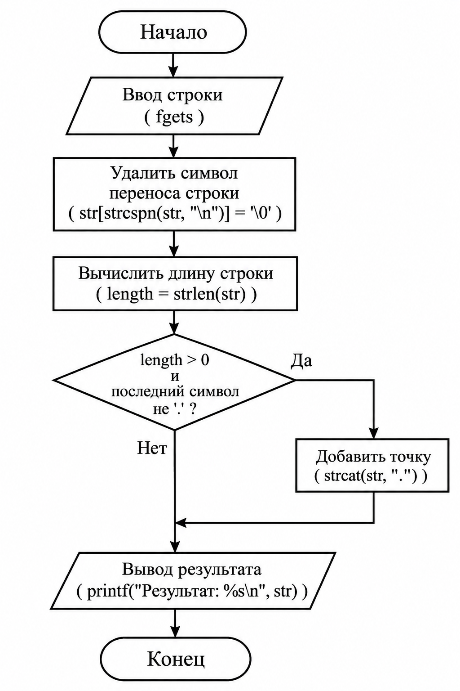

## ДОМАШНЕЕ ЗАДАНИЕ К РАБОТА 12

## Условие

Написать программу, которая проверяет, заканчивается ли введённая пользователем строка точкой. Если точка отсутствует, необходимо добавить её в конец строки.

## 1. Алгоритм работы программы

1. Начало программы.
2. Подключение необходимых библиотек.
3. Объявление массива символов для хранения строки.
4. Ввод строки пользователем.
5. Удаление символа переноса строки.
6. Определение длины строки.
7. Проверка последнего символа:
   - если последний символ не является точкой, добавить точку;
   - если строка уже заканчивается точкой, оставить её без изменений.
8. Вывод итоговой строки.
9. Конец программы.

## Используемые функции

- `setlocale()` — настройка локали.
- `fgets()` — ввод строки.
- `strcspn()` — удаление символа переноса строки.
- `strlen()` — определение длины строки.
- `strcat()` — добавление точки.
- `printf()` — вывод результата.

## Блок-схема алгоритма



[Открыть блок-схему в полном размере](block_scheme.png)

## 2. Реализация программы

Программа реализована на языке C в среде Microsoft Visual Studio с использованием стандартных библиотек для работы со строками.

## 3. Результат работы программы

**Первый вариант (точка отсутствует):**

```text
Введите строку: Привет, мир
Результат: Привет, мир.
```

**Второй вариант (точка уже есть):**

```text
Введите строку: Привет, мир.
Результат: Привет, мир.
```

## Информация о разработчике

Запорин Артём, бТИИ-262
